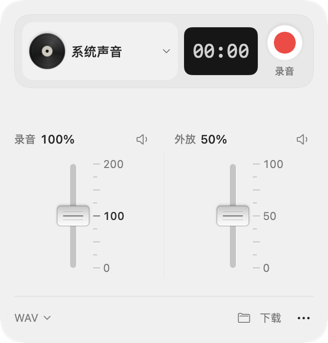

# Audio Loom · 声流

A compact, local-first macOS menu-bar audio recorder with independent output-volume control.

一个小巧的 macOS 菜单栏录音工具：黑胶碟机风格的控制区、真实波形、独立双推子，以及自动保存。



> **实验性项目。** 当前代码版本为 0.7.0，主要在 Apple Silicon 上开发和验证。它不是 Audio Hijack 的修改版、破解版本或完整替代品，与 Rogue Amoeba 无关联。

## 功能

- **音源选择**：单个运行应用，或系统声音。
- **四种录音格式**：WAV、M4A/AAC、AIFF、MP3。
- **自动保存**：直接写入系统 Downloads 文件夹，时间命名、防覆盖；正常停止并保存成功后在 Finder 中选中文件。
- **双推子**：录音增益 0–200%；外放音量 0–100%。两者互不联动，外放调节不需要录音。
- **真实可视化**：录音流的双声道包络与 L/R 峰值，不伪造空闲动画。
- **菜单栏反馈**：录音红点与时长，以及静音、保存中和错误状态。
- **高级处理链**：可拖拽连接音源、增益、单声道与录音模块；保留在更多菜单中，不占日常界面。

| 格式 | 编码 |
|---|---|
| WAV | 48 kHz，双声道，32 位浮点 PCM |
| M4A | 48 kHz，双声道，AAC，目标 256 kbps |
| AIFF | 48 kHz，双声道，24 位整数 PCM |
| MP3 | 48 kHz，双声道，LAME，320 kbps |

不包括麦克风、多音源混音、多路输出、实时监听、虚拟声卡、AU 插件、排程或 FLAC。

## 从源码构建

需要 **macOS 14+**、Xcode / macOS SDK、Swift 5.9+、系统编译工具和 Python 3。Apple Silicon 是主要验证平台，Intel 和其他 macOS 版本未逐一验证。

```sh
bash build.sh
open dist/声流.app
```

应用位于 `dist/声流.app`。这是菜单栏工具，不会出现在 Dock 中；打开后点击顶部波形图标。

第一次构建会从仓库附带的、带校验值的 LAME 源码生成当前架构的动态库。**仓库不提交预编译动态库、应用包或用户录音。** 构建不需要下载第三方源码，也不需要安装系统音频驱动。

如果想单独重建 MP3 库：

```sh
bash Tools/build-lame.sh
```

本地构建使用临时签名，**没有 Apple Developer ID 签名或公证**。在其他 Mac 上分发时，系统可能阻止首次打开。请只运行可信来源的构建，并遵循 macOS 提供的安全提示，不要关闭系统保护。

## 使用

1. 在左侧黑胶区域选择软件或系统声音。
2. 在底部选择输出格式，点击「录音」。
3. 首次按 macOS 提示允许录音和 Downloads 访问权限。
4. 点击「停止」，文件完整保存成功后会自动在 Finder 中选中。

文件名类似 `声流_2026-11-17_12-30-00-123.mp3`。不会每次询问保存位置；系统自身的隐私授权提示仍可能出现。

关闭弹窗不会中断已启动的录音。退出应用时会尝试正常停止并保存，但不额外打开 Finder。保存失败或没有接收到音频时，不会误选之前的文件。

### 推子

- **录音**控制处理链中的第一个启用的增益模块；100% 为原始音量。
- **外放**控制 macOS 当前默认输出设备，与所选录音应用无关。
- 方向键按 1% 调整，Option 拖动更精细；真实外放步进仍由硬件决定。
- 外放归零按钮再次点击会恢复之前音量，未知之前音量时使用 25%。
- 不接管系统音量键，也不强制解锁 macOS 原有的音量滑块。

## 外放控制与兼容性

普通音频设备优先使用可写的 Core Audio 主音量。

部分通过 HDMI / DisplayPort 连接的显示器不提供系统音量接口。本项目可在 Apple Silicon 上尝试 **DDC/CI VCP 0x62** 硬件音量控制，但只在默认音频输出、外接屏名称与硬件接口能唯一对应时启用。多屏、镜像、转接器或不明确的配置会被拒绝，而不是猜测目标设备。

**显示器控制使用动态检测的 Apple IOAV 未公开接口**，不保证未来 macOS 兼容，也不代表适合 App Store 发布。请确保显示器支持并开启 DDC/CI。写入后会读回确认，设备切换时不会把旧音量意图应用到新设备。

## 隐私与限制

- 只在用户明确点击开始后捕获音频；不自动录音、不采集麦克风、不上传音频。
- ScreenCaptureKit 的显示器过滤方式可能需要“屏幕与系统音频录制”权限。未使用的视频通道设为 2×2，收到画面帧后立即丢弃，不预览、分析或保存。
- 外放控制不创建音频捕获流，不安装虚拟声卡，不修改录音处理链。
- 波形只保留内存中的有限长度包络；不是 FFT 频谱或声压计。
- 高于 100% 的增益可能削波失真；输出保护不是专业压缩器或限幅器。
- 单次录音按未压缩输入量限制为约 2 小时 36 分钟；压缩格式也暂用同一时长上限。
- 受保护内容、辅助音频进程和部分应用可能无法捕获。浏览器通常按应用而不是按单独标签页捕获。
- 正常退出会尝试收尾；强制结束、断电或磁盘故障时不保证文件可恢复。
- 请只录制有权录制的内容，并取得必要同意。

## 测试

```sh
bash Tools/build-lame.sh
swift test
```

现有 105 项单元测试覆盖音频处理、路由、四种格式、波形、命名与并发防覆盖、菜单栏状态、保存策略和外放协议边界。测试使用合成 PCM 与临时文件，不需要采集真实音频或改变硬件音量。

GUI 自测及人工验收范围见 [测试说明](docs/TESTING.md)。GitHub Actions 只执行构建和无硬件的单元测试；不要将它理解为真实设备录音或 DDC 写入兼容性的保证。

## 项目结构

```text
Sources/AudioLoom/       原生菜单栏界面与录音生命周期
Sources/AudioCore/       PCM、处理链、波形与文件编码
Sources/OutputControl/   与录音独立的音量接口和 DDC 校验
Tests/                  合成数据与安全边界测试
Tools/                  图标生成与 LAME 重建
Vendor/LAME/            上游源码、校验值、许可证
```

设计方向见 [DESIGN.md](DESIGN.md)，参与方式见 [CONTRIBUTING.md](CONTRIBUTING.md)。

## 许可证

项目原创代码及原创资源采用 [MIT](LICENSE)。

第三方组件保留原许可证：

- **LAME 3.100**：LGPL-2.0-or-later，动态链接；完整许可证与相应源码随仓库提供。
- **m1ddc 参考/改编的接口与报文实现**：MIT，版权说明保留。

详见 [THIRD_PARTY_NOTICES.md](THIRD_PARTY_NOTICES.md) 和 [LAME 说明](Vendor/LAME/README.md)。不要将顶层 MIT 许可证理解为对第三方代码重新授权。
